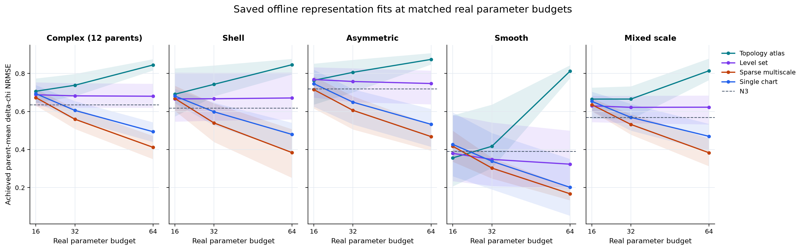
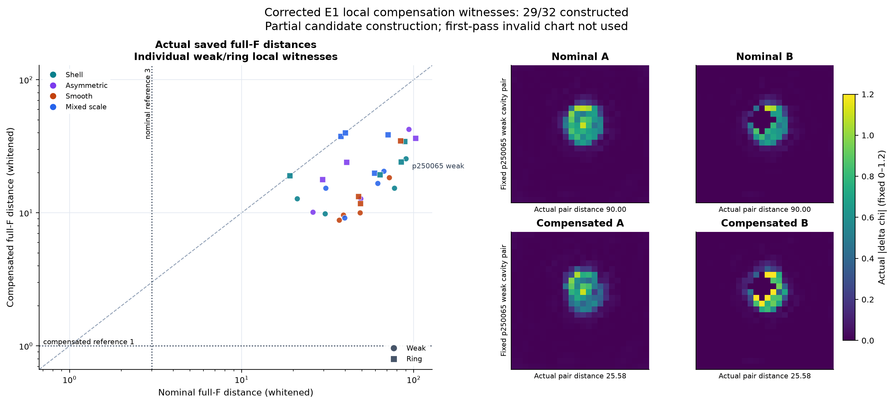

# A30 — Maxwell-Observable Material Manifold

**E0: PASS for OFFLINE capacity. E1: NO-GO to E2 under the implemented protocol.**

完整中文研究入口：[A30_E0_E1_DECISION.md](A30_E0_E1_DECISION.md)。原理论包保持在[theory/package](theory/package/)。A29原冻结NO-GO不改写；全部实验是已暴露development，不是新的盲测。

|实际结果|复杂parent相对N3材料改善|
|---|---:|
|完整候选hard oracle|2.15%|
|完整候选convex oracle|13.12% [11.51%,14.65%]|
|真实L-weighted mean|−3.32%|
|32参数固定支持稀疏拟合|11.68%|
|64参数固定支持稀疏拟合|35.69% [29.50%,42.81%]|
|64参数TRAIN-PCA拟合|21.91%|

**Oracle和truth拟合的连续表示都不是在线算法。**容量存在，但本次没有实现能由测量找到这些参数的重建器。当前atlas/level-set实现没有胜过N3；其非凸拟合不证明全局容量不足。

E1完成29/32个合法局部补偿对，3个条件没有注册cavity候选。最小实际补偿后full-F白化距离8.84，没有达到原≤1目标。局部优化与保守误差界的限制均保留，未证明全局补偿不存在。累计161次真实full-wave调用/192总硬上限，包括实现错误；首次多保护mask造成的60次冗余调用超过原32次失败预留，作为执行偏差公开记录。没有训练、没有新truth标签、没有打开locked数据、没有E2。

## 物理和证据范围

复用固定A29/A24 **二维标量TM** backend：24×24、8sources/32receivers、complex128、真实材料box和质量坐标。不能把它写成3D Vector-Maxwell验证。当前标签的材料增量复相位固定。

|入口|内容|
|---|---|
|[中文决策报告](A30_E0_E1_DECISION.md)|机制判断、完整数据、失败与预测|
|[冻结配置](a30_config.json)|原协议阈值、预算、TRAIN-only规则及修正|
|[最终结构化决定](results/a30/FINAL_DECISION.json)|GO/NO-GO、缺失、付款和禁止项|
|[逐parent表](results/a30/PARENT_STATISTICS.csv)|每parent先平均weak/ring|
|[完整容量表](results/a30/capacity/CAPACITY_CASES.csv)|384个请求、16/32/64预算|
|[完整凸包表](results/a30/hull/HULL_MATERIAL_AND_STRUCTURE.csv)|hard/hull/真实L mean与结构|
|[补偿表](results/a30/compensation_corrected/COMPENSATION_PAIRS.csv)|全部32行，缺失及优化cap保留|
|[失败账本](results/a30/FAILURE_LEDGER.jsonl)|无效首次补偿、缺候选、迭代cap|
|[实际物理调用](results/a30/PHYSICAL_STATE_LEDGER.jsonl)|统一预约，全分辨率/重复也计费|
|[成本账本](results/a30/COST_LEDGER.jsonl)|实际CPU任务及发布费用|





## 原始证据与复现输入

本项目大型数组及384个拟合的逐起点/逐迭代记录：[A30 Release](https://github.com/migodam/a30-maxwell-observable-material-manifold/releases/tag/a30-e0-e1-v0.1.0)，资产`A30_E0_E1_RAW_RESULTS.zip`。它包含本实验的容量图像、convex hull材料、补偿端点、拟合参数与轨迹。没有locked数据或新的神经模型。

原始输入：[A29 a29-v0.1.0](https://github.com/migodam/a29-material-hypothesis-coverage/releases/tag/a29-v0.1.0)中的`A29_RAW_EVIDENCE.zip`和`A29_REPRO_INPUTS.zip`。源commit为`5d5e31fcfc56ac8ef9d64c46b4b7bbdedef96bb4`。不做hash/SHA256校验。

## 命令

CPU只需要NumPy、SciPy、Matplotlib；Torch仅用于现有冻结Torch adapter的可选算术测试。没有CUDA安装或新调度器。实际运行环境见[ENVIRONMENT.json](results/a30/ENVIRONMENT.json)。

```bash
python -m pip install numpy scipy matplotlib
python tools/get_a29_inputs.py --root .
export OPENBLAS_NUM_THREADS=1 OMP_NUM_THREADS=1 PYTHONPATH=src

# 原协议的32条件convex诊断；仅缓存/小矩阵，不支付新全波
python theory/package/run_a29_1_guarded.py --root inputs/a29_release --out results/a30/hull
python theory/package/a30_topology_supplement.py --root inputs/a29_release --results results/a30/hull
python -m a30.hull_audit --root .

# 实际容量；8起点/100迭代/16,32,64，truth只用于明确的offline拟合
python tools/a30_job.py --root . --job reproduce-capacity --stage e0 --seconds 2400 -- python -m a30.capacity --root .
python tools/a30_job.py --root . --job reproduce-figures --stage report --seconds 90 -- python tools/a30_report_figures.py --root .
```

上面E0仅依赖公开缓存。原物理运行命令为：

```bash
python tools/a30_job.py --root . --job compensation-002 --stage e1 --seconds 900 -- python -m a30.compensation --root .
```

**不要在这个已付款campaign上直接重跑E1**：账本保留161次调用，再次完整运行会被192硬上限拒绝。新物理复现需要新的独立实验预算和输出目录；不能删账本后冒充本campaign未使用额度。修正版算法在没有首次错误历史结果时直接算nominal响应；已有真实标量则复用，不因没有保存全部LU而重算无用标签。

机械检查：`python theory/package/a30_algebra_checks.py`、`python -m unittest discover -s tests`。它们不等于成像收益或强散射证书。已有真实输出已随仓库/Release公开，不必为了阅读结论重跑物理。

## 最终判断

当前值得保留的是简单材料表示的**容量与测量选择问题**。当前bounded compensation没有找到足够的难区分结构对，不推进certificate-guided full-F或E2。预测应由后续新协议检验，不在这里自动设计新网络、开展训练或扩大物理实验。

公开仓库：[a30-maxwell-observable-material-manifold](https://github.com/migodam/a30-maxwell-observable-material-manifold)

匿名Markdown：[可直接给GPT读取的报告](https://raw.githubusercontent.com/migodam/a30-maxwell-observable-material-manifold/main/A30_E0_E1_DECISION.md)
